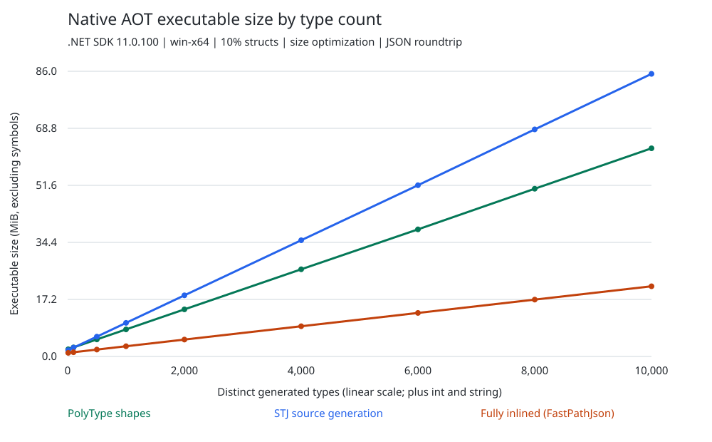

# Design questions and tradeoffs

This page answers questions that frequently come up when evaluating PolyType's design: runtime cost, Native AOT footprint, the choice of a runtime type model over generated code, and what the library offers when serializers can be written by hand or by an agent. Where possible, the answers cite measurements; the [reproducibility notes](#reproducing-the-measurements) describe how they were collected.

## Performance

### Doesn't the visitor model add overhead compared with STJ or a fully generated serializer?

The visitor need not run in the hot path. A [`TypeShapeVisitor`](xref:PolyType.Abstractions.TypeShapeVisitor) traverses the *type graph* to build converters, delegates and lookup tables. A library can cache these components and use them to process values without revisiting their shapes. The [example JSON serializer](https://github.com/eiriktsarpalis/PolyType/tree/main/src/PolyType.Examples/JsonSerializer) uses this pattern; a visitor that traverses the shape for every value would add overhead.

The resulting converter graph can still involve virtual calls and member-access delegates during value traversal, as can System.Text.Json's metadata mode. A generator can instead emit direct serialization code, much like a handwritten serializer. The [`PolyType.FastPathJson`](https://github.com/eiriktsarpalis/PolyType/tree/main/src/fast-path-json) prototype uses `PolyType.Roslyn` to illustrate this option.

The following means come from the [performance benchmarks](performance.md), measured on an Apple M4 Pro with .NET 11. They compare complete serializers rather than isolating visitor overhead:

| Benchmark | STJ metadata | PolyType source gen | Hand written JSON |
|---|---:|---:|---:|
| Serialize small POCO | 144.6 ns | 92.3 ns | 66.3 ns |
| Deserialize small POCO | 545.9 ns | 267.1 ns | 237.4 ns |
| Serialize large POCO | 638.0 ns | 567.0 ns | 494.5 ns |
| Deserialize large POCO | 1,770.1 ns | 1,391.7 ns | 1,302.1 ns |
| Serialize CITM catalogs | 3.11 ms | 1.73 ms | 1.51 ms |
| Deserialize CITM catalogs | 7.77 ms | 5.64 ms | 5.16 ms |

The PolyType column uses the example JSON serializer, a reference implementation rather than a production library. Differences also reflect serializer algorithms, not only dispatch. For example, the handwritten serializer is about 1.4 times as fast as the composed one for small POCO serialization in this benchmark.

### What does the visitor model cost at startup?

Building and caching converters has an initial cost, typically paid when a library first encounters a type with a given provider and configuration. The following medians measure one deserialize-and-serialize roundtrip of a flat 50-type graph inside a fresh process, and the wall time of that process. The graph has one root type with properties referencing 49 independent types:

| Runtime | Serializer | First roundtrip (ms) | Process (ms) |
|---|---|---:|---:|
| JIT | PolyType reflection | 224.75 | 305.16 |
| JIT | PolyType source gen | 166.11 | 247.86 |
| JIT | STJ reflection | 102.87 | 182.08 |
| JIT | STJ source gen | 118.73 | 197.83 |
| JIT | FastPathJson | 126.33 | 208.47 |
| JIT R2R | PolyType source gen | 105.95 | 189.47 |
| JIT R2R | STJ source gen | 63.73 | 145.77 |
| JIT R2R | FastPathJson | 7.85 | 89.45 |
| Native AOT | PolyType source gen | 30.95 | 57.06 |
| Native AOT | STJ source gen | 1.43 | 26.62 |
| Native AOT | FastPathJson | 0.32 | 24.27 |

The measurements include serializer initialization and the first roundtrip, not just visitor dispatch. Ordinary JIT builds can pay compilation costs on first use; ReadyToRun precompiles applicable methods but can still JIT-compile methods not covered by its images. A separate Native AOT flame graph localizes PolyType's generic dispatch cost: for a 100-type graph, 6,708 of 7,043 JSON-first-use samples (95%) include `ResolveGvmDispatch`, leading into runtime type-loader construction of generic methods and dictionaries; most self time is in array resizing and buffer copies. STJ had no GVM-resolution frames among its 201 samples, though this short profile does not show that STJ never uses GVMs. These flame graphs came from `EventSourceSupport`-enabled diagnostic builds, so they identify the work rather than provide timing medians. Applications sensitive to first-request latency can initialize converters ahead of time; a generator that emits direct serialization code offers another tradeoff.

## Static footprint

### Do generic virtual methods blow up Native AOT size?

The [visitor](core-abstractions.md) methods and `ITypeShapeFunc.Invoke<T>` callbacks are generic virtual methods (GVMs). Native AOT may need to generate code and runtime dispatch data for combinations of used method instantiations and their implementations, including combinations not called directly; see its [GVM dependency analysis](https://github.com/dotnet/runtime/blob/main/src/coreclr/tools/Common/Compiler/DependencyAnalysis/GVMDependenciesNode.cs). The resulting product can be described as $N_{\text{visitors}} \times N_{\text{types}}$. Here, $N_{\text{visitors}}$ counts the builder visitor types that override these methods. These types are typically nongeneric, so each consuming library contributes a fixed number of visitors, independent of the graph's type count. Thus, for libraries using this design, $N_{\text{visitors}}$ grows with the library count, not the type graph.

For a fixed set of libraries, $N_{\text{visitors}}$ is constant as the type graph grows, so GVM expansion is linear in the number of relevant instantiations. Value-type arguments generally need specialized code, while reference types can share canonical code. This analysis follows from the compiler's dependency rules; the measurements below use one library at a time.

The following chart measures Native AOT executable sizes for a JSON roundtrip of binary-tree type graphs, in which 10% of the types are structs. It compares PolyType's example serializer with STJ source generation and the handwritten `PolyType.FastPathJson` serializer:

| Types | PolyType | STJ source gen | FastPathJson |
|---:|---:|---:|---:|
| 10 | 2.16 MiB | 1.89 MiB | 1.09 MiB |
| 100 | 2.72 MiB | 2.65 MiB | 1.27 MiB |
| 500 | 5.14 MiB | 5.97 MiB | 2.08 MiB |
| 1,000 | 8.16 MiB | 10.13 MiB | 3.08 MiB |
| 2,000 | 14.20 MiB | 18.43 MiB | 5.09 MiB |
| 4,000 | 26.29 MiB | 35.05 MiB | 9.11 MiB |
| 6,000 | 38.33 MiB | 51.64 MiB | 13.13 MiB |
| 8,000 | 50.58 MiB | 68.48 MiB | 17.14 MiB |
| 10,000 | 62.78 MiB | 85.23 MiB | 21.16 MiB |

For this graph and configuration, Native AOT executable size grows linearly with the number of types for all three serializers.

These are whole executable sizes, not an isolated measurement of GVMs or managed memory. They cover one synthetic graph and do not establish a bound for every possible application.

By way of comparison, LINQ's generic `Iterator<TSource>` has composable iterator implementations and a generic `Select<TResult>` method, so both dimensions can grow. PolyType's visitors are non-generic and do not compose into new visitor types; for a fixed library set, only shape instantiations grow, with no corresponding multiplicative effect.

### What about runtime memory?

Runtime shapes and cached converters occupy managed memory, and their cost depends on the type graph, provider and library. A separate CoreCLR experiment measured the live managed heap after the first validated JSON roundtrip and a full collection, using the same flat 50-type graph as above. The applications are framework-dependent .NET 11 Release builds, without ReadyToRun or Native AOT:

| Implementation | Live managed heap (median) |
|---|---:|
| PolyType source generation | 429.4 KiB |
| `System.Text.Json` source generation | 450.8 KiB |
| FastPathJson | 269.1 KiB |

Each process performs one deserialize/serialize roundtrip, then forces two full collections with pending finalizers drained between them before measuring the live managed heap. The input remains alive through the measurement. Values are medians of 30 fresh processes per implementation, run in interleaved order. These are total managed-heap measurements, not increases over a baseline; they include reachable serializer caches and other live managed objects, but exclude native memory and unused GC-committed pages. The results describe this graph and workload, not a general per-type cost.

## Runtime metadata

### I don't want runtime metadata. Can I generate code at compile time instead?

Yes. [`PolyType.Roslyn`](https://www.nuget.org/packages/PolyType.Roslyn) is a source-only package that exposes a compile-time type model to Roslyn source generators, mapping `ITypeSymbol` instances to data models of objects, collections, enums, unions and so on. `PolyType.FastPathJson` is a prototype JSON generator built this way; it uses no runtime shapes, and its numbers appear in the tables above.

Generating handwritten code has tradeoffs that a runtime type model avoids:

- **Runtime configuration.** A library can use a runtime model to support naming policies, reference preservation, number handling, rules for skipping default or null values, and contract customization. A fixed, fully generated method cannot accommodate policies unknown at generation time without adding runtime checks, callbacks or other customization mechanisms.
- **Testability.** A runtime library can be tested against the [reflection provider](shape-providers.md) and the shared test types of [`PolyType.TestCases`](https://github.com/eiriktsarpalis/PolyType/tree/main/src/PolyType.TestCases), with no generator in the loop. Testing a generator also involves compilation, snapshot and incrementality tests.
- **Effort.** A generator must emit source that works with the target's syntax, accessibility and language version. `PolyType.Roslyn` helps extract the model, while a runtime library can use accessors supplied by a shape provider.

### Does `[GenerateShape]` root every type and defeat trimming?

Not necessarily. Generated shape instances are initialized lazily, and statically resolved shapes can allow the trimmer to remove unused generated shapes. Two issues that rooted unnecessary shapes, [#339](https://github.com/eiriktsarpalis/PolyType/issues/339) and [#544](https://github.com/eiriktsarpalis/PolyType/issues/544), have been fixed. Laziness alone does not guarantee trimming: resolving through the non-generic `ITypeShapeProvider.GetTypeShape(Type)` method of a source-generated provider can still root every shape that provider contains. Prefer the generic `IShapeable<T>` APIs in trimmed applications.

## Building libraries

### Why use PolyType when an agent can write a serializer?

An agent can produce a serializer for the types it is shown. The difficulty lies in the types it is not shown: collections with unusual construction patterns, immutable and frozen collections, read-only and init-only members, required members, parameterized constructors, nullable value types, enums, unions, recursive and generic types, and the interaction of these with Native AOT and trimming. PolyType already models these, and both of its providers are tested against the same type catalog.

PolyType also gives an agent narrower guardrails: the shape abstractions provide a common, strongly typed model, and the visitor separates handling by shape kind. The [`PolyType.TestCases`](https://www.nuget.org/packages/PolyType.TestCases) package exposes a catalog of types, values and shapes that a library can add to its test suite. [`PolyType.Examples`](https://github.com/eiriktsarpalis/PolyType/tree/main/src/PolyType.Examples) provides reference implementations. A library still needs to implement and test the behavior it promises for each shape.

### Is the programming model too complex for library authors?

The model is more involved than reflection, because it uses generic visitors to preserve static typing. That complexity is confined to library authors; consumers apply `[GenerateShape]` and call the library. Library authors can study the example implementations, and the PolyType packages ship [agent skills](https://github.com/eiriktsarpalis/PolyType/tree/main/.github/skills) for authoring libraries and generators.

### Is the API stable?

The package enables API compatibility validation against the 1.0.0 baseline, which detects many breaking public API changes. Libraries such as [Nerdbank.MessagePack](https://github.com/AArnott/Nerdbank.MessagePack) build on PolyType.

## Reproducing the measurements

The Native AOT size comparison was collected on November 21, 2026, from repository revision `53894bd23819b206aa879f3597270ceb297c4e89`, using .NET SDK 11.0.100 on Windows 11 x64. The machine had an Intel Xeon Platinum 8370C processor, 8 cores and 64 GiB of RAM.

For each point, construct a balanced binary tree of distinct types, numbered in breadth-first order from one. The children of node `n` are `2n` and `2n + 1` when those indices are within the requested count. Each type has public, writable `int Id` and `string Name` properties and up to two properties for its concrete child types. Make every tenth type a struct and the others sealed classes; class-valued child properties are nullable and struct-valued child properties are not. Count node types, excluding the two shared scalar types. Populate every node with its index and a distinct name, and use the same external JSON input for all three applications.

Build separate .NET 11 Release applications for `win-x64`. Use source-generated PolyType shapes with `PolyType.Examples.JsonSerializer.JsonSerializerTS`, an STJ context using `JsonSourceGenerationMode.Default`, and the `PolyType.FastPathJson` prototype. Each application deserializes and reserializes the input and verifies that the output matches it. Publish with `PublishAot=true`, `OptimizationPreference=Size`, `InvariantGlobalization=true`, `StackTraceSupport=false` and `JsonSerializerIsReflectionEnabledByDefault=false`. The Windows linker option `/DEBUG:LongSymbolTruncate` permits long generated symbol names.

Record each executable's file length, excluding its PDB and other publish artifacts. The chart reports MiB, where one MiB is 1,048,576 bytes. The fast-path prototype and the example serializer do not implement every feature of STJ, so the comparison applies to this shared roundtrip rather than their full feature sets.

The startup comparison was collected on November 22, 2026, using the same machine, SDK and repository revision. Its graph is flat rather than a binary tree: `Node1` has `int Id`, `string Name`, and a property for each of the 49 other types, `Node2` through `Node50`. Each child has only `int Id` and `string Name`. Every tenth node is a struct and the others are sealed classes; class-valued child properties are nullable and struct-valued properties are not. The 50-type count includes the root but excludes the scalar types. All nodes are populated in the input.

The startup experiment publishes separate Release applications for each serializer using framework-dependent JIT, framework-dependent JIT with `PublishReadyToRun=true`, and self-contained Native AOT. The ReadyToRun rows cover the non-reflection variants. The STJ source-generated contexts explicitly use `JsonSourceGenerationMode.Metadata`, so none of the JIT or Native AOT results uses the generated serialization fast path. STJ reflection is enabled only for its reflection-based variant. Each process reads the input before timing its first deserialize-and-serialize roundtrip; a parent process separately measures wall time from process launch through exit, including input reading and validation. After one discarded run per variant to warm file-system caches, the experiment records 30 interleaved runs per variant and reports medians. These are warm-file-cache, single-host measurements; they do not represent cold-disk startup or isolate visitor costs.
