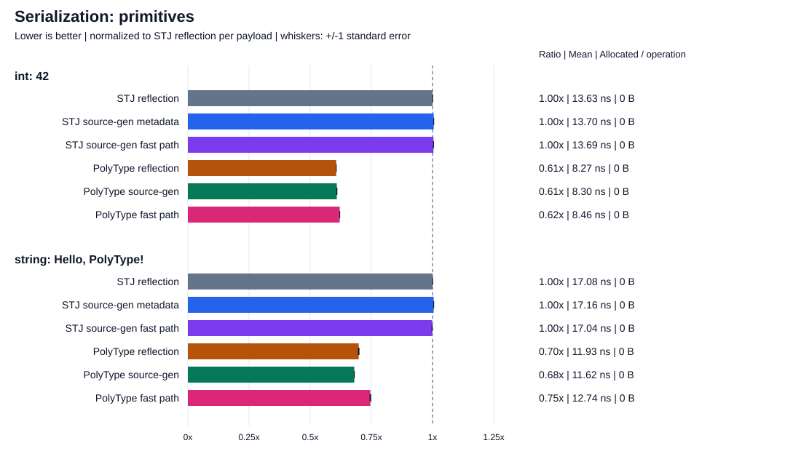
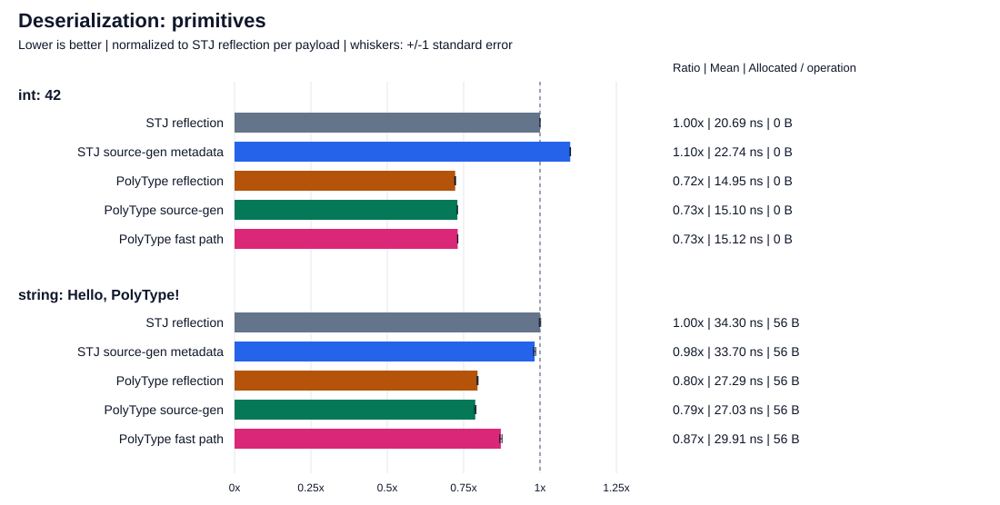
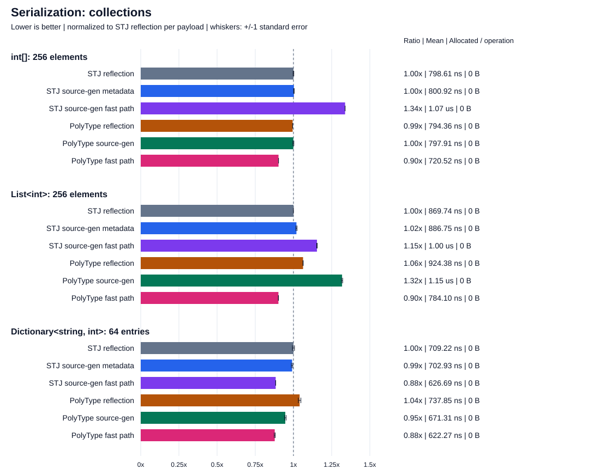
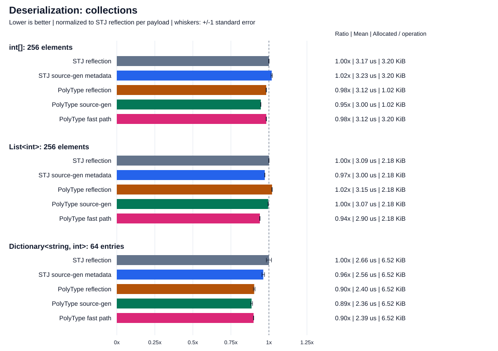
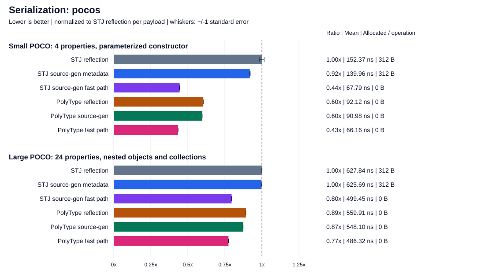
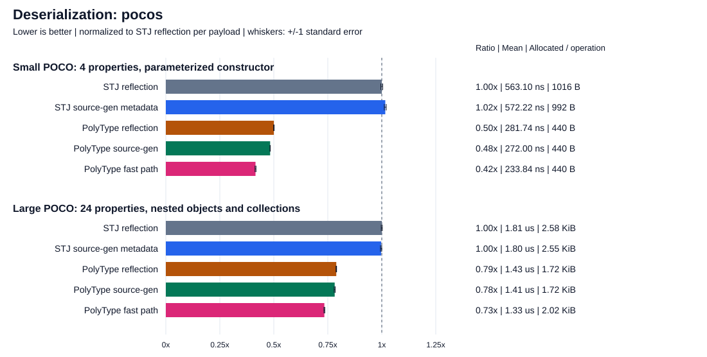
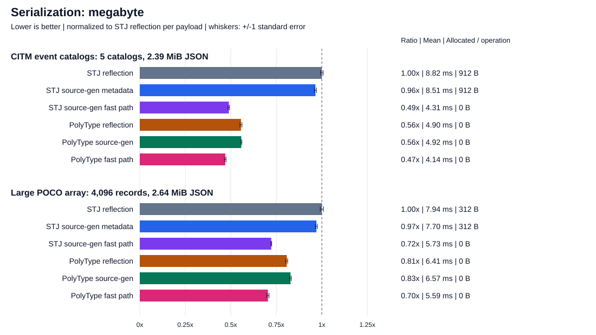
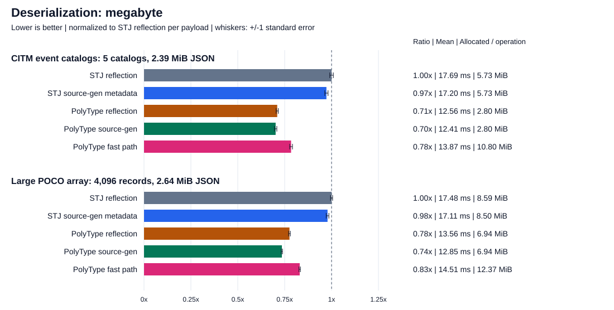

# Performance

## Case study: a JSON serializer

The [example JSON serializer](https://github.com/eiriktsarpalis/PolyType/tree/main/src/PolyType.Examples/JsonSerializer) uses the runtime type-shape abstractions in `PolyType.dll`. This case study measures its throughput and allocations against System.Text.Json (STJ), using the same `Utf8JsonWriter` and `Utf8JsonReader` primitives.

**PolyType reflection** and **PolyType source-gen** run the same serializer with reflection-provided and source-generated shapes, respectively. Both use `PolyType.dll` at runtime; source generation supplies type shapes, not a fully generated serializer. The example is a reference implementation, not a production library.

**[PolyType fast path](https://github.com/eiriktsarpalis/PolyType/tree/main/src/fast-path-json)** is a fully optimized serializer generated using the `PolyType.Roslyn` abstractions. It is included throughout as a baseline, not as a measurement of the runtime abstractions in `PolyType.dll`.

The [benchmark suite](https://github.com/eiriktsarpalis/PolyType/blob/main/tests/PolyType.Benchmarks/JsonBenchmark.cs) compares nine payloads, from a single integer to megabytes of JSON, across six serialization and five deserialization configurations. All use default JSON settings, cached metadata/converters, and equivalent valid inputs. Setup checks that every serialization path produces equivalent JSON and that all deserialization paths round-trip correctly.

All **99 measurements** and all eight charts were refreshed on **October 28, 2026**, using the same benchmark job settings as the previous run.

Measurements used an Apple M4 Pro (14 cores, Arm64), macOS 27.0.1 (26A434), BenchmarkDotNet 0.16.0-preview.2, and .NET 11.0.0-rc.3.26522.148 with SDK `11.0.100-rc.3.26522.148`, Release configuration, and concurrent server GC. BenchmarkDotNet could not elevate process priority on this host. Host and runtime details are included in the exported dataset.

### Reading the charts

**Shorter bars are better.** Each payload is normalized independently: STJ reflection is **1.00x**, and a 1.20x bar means 20% more elapsed time for that payload. Absolute mean time and managed allocations per operation appear beside every bar. Do not compare the absolute cost of different payloads using bar lengths alone.

Whiskers show **+/- one standard error**, not confidence intervals. Every case uses the same BenchmarkDotNet job: **one launch, six warmup iterations, and twelve measurement iterations** before outlier removal. Small differences do not establish a reliable performance ranking. The [machine-readable results](../images/performance/results.json) include measurement samples, confidence intervals, allocations, job settings, and environment details.

The comparison includes STJ reflection, STJ source-generated metadata, PolyType reflection, PolyType source-generated shapes, and PolyType fast path. Serialization also includes STJ's source-generated fast-path context. That context can use built-in converters for types without a generated serialization handler. STJ does not provide an equivalent generated deserialization fast path. The text abbreviates STJ's source-generated metadata configuration as **STJ metadata**.

### Serialization

With source-generated shapes, PolyType's collection and object writers took **1.06-1.34x** the time of the PolyType fast path baseline. Its small- and large-POCO writers took **1.35x and 1.11x** the time of STJ's fast path, respectively, while using **35% and 11% less elapsed time** than STJ metadata. The `List<int>` writer took **1.09x** the time of STJ metadata; the `int[]` writer was effectively tied. These comparisons describe measured means on this host, not cross-platform guarantees or significance tests.

Both shape-driven PolyType configurations and the fast-path baseline allocated no managed memory in these warmed, reused-buffer serialization cases. This does not include producing a new output string or byte array for each call.

### Deserialization

With source-generated shapes, the PolyType reader used **6-52% less elapsed time than STJ metadata** across seven of the nine payloads. The `int[]` reader was effectively tied (**0.99x**), while `List<int>` took **1.03x** the time of STJ metadata. For the large POCO, CITM batch, and large-object batch, its times were **1.07x, 1.09x, and 1.08x** the PolyType fast path baseline, respectively.

For the CITM batch, the PolyType reader with source-generated shapes allocated **2.80 MiB per read**, compared with **5.73 MiB** for both STJ metadata and the PolyType fast path baseline. For the small POCO, both shape-driven PolyType readers and the fast-path baseline allocated **440 B per read**.

The benchmark measures complete serializers, not the isolated cost of a visitor or member accessor. Differences include serializer algorithms and collection construction as well as dispatch and member access through type shapes. Shape and converter construction are excluded from the timed operations.

Serialization reuses a `Utf8JsonWriter` and `ArrayBufferWriter<byte>`, including flushing and reset in each operation. Deserialization consumes precomputed UTF-8 input and includes result construction. Startup, Native AOT execution, streaming I/O, dataset loading, and initial buffer allocation are not measured. The valid-input comparison does not imply equivalent handling of malformed JSON or unsupported contracts.

## Primitives

An `int` with value `42` produces 2 bytes of JSON; `"Hello, PolyType!"` produces 18 bytes. These cases emphasize fixed per-call overhead rather than object traversal or collection handling.





## Collections

The `int[]` and `List<int>` each contain integers 0 through 255 (915 bytes of JSON). The `Dictionary<string, int>` contains 64 entries, named `key0` through `key63` (685 bytes). Including both arrays and lists exposes differences in traversal and collection construction that a POCO-only benchmark would miss.





## Small and large POCOs

The small POCO preserves the original benchmark: four properties, a parameterized constructor, a three-element list, and a two-entry dictionary (77 bytes of JSON).

The large POCO has 24 properties: numeric values, booleans, strings, a timestamp, a GUID, arrays, a dictionary, and a nested small POCO (669 bytes). This tests a wider object model, not merely a longer string.





## Megabyte-scale payloads

The **CITM event catalog** is a common JSON benchmark dataset distributed by [nativejson-benchmark](https://github.com/miloyip/nativejson-benchmark/tree/478d5727c2a4048e835a29c65adecc7d795360d5). It contains events, performances, ticket prices, seating categories and areas, topic mappings, nullable fields, and non-ASCII names. The benchmark uses typed POCOs, dictionaries, and nested arrays, not `JsonDocument` or `JsonElement`.

The original file is 1,727,204 bytes including whitespace, but only about 0.5 MB when serialized compactly. To measure a genuinely multi-MB workload, the fixture contains **five independently loaded catalogs**, totaling **2,505,471 UTF-8 bytes** (2.39 MiB). Each catalog contains 184 events and 243 performances, so the batch has 920 events and 1,215 performances plus their nested records. This is a scaled version of the dataset, not the standard single-catalog benchmark.

The pinned dataset is embedded in compressed form with its [MIT license and provenance](https://github.com/eiriktsarpalis/PolyType/blob/e7f8c3750fd2529d3729af86d5639dbccf0fddea/tests/PolyType.Benchmarks/Data/NOTICE.txt). Decompression, loading, and comparison of the complete typed model against the original JSON occur only during setup. The measured deserialization input is compact JSON generated from the batch with the same default escaping settings for all serializers.

A second workload contains **4,096 distinct large POCOs**, totaling **2,763,729 UTF-8 bytes** (2.64 MiB). Both fixtures are checked to exceed 2 MB of serialized JSON before measurement.





## Reproducing the benchmarks

Install a .NET SDK compatible with `global.json`. Run the following commands from the repository root without other build/test workloads running concurrently. Set `artifacts` to an unused directory for each run.

```bash
artifacts='artifacts/json-benchmarks'
dotnet run --project tests/PolyType.Benchmarks -c Release -- --validate-json
dotnet run --project tests/PolyType.Benchmarks -c Release --no-build -- \
  --filter '*Json*' --job short --warmupCount 6 --iterationCount 12 \
  --exporters json --artifacts $artifacts
dotnet run --file eng/plot-json-benchmarks.cs -- "$artifacts/results"
```

The plotting command requires the complete 99-case result set. It writes eight SVG charts and `results.json` under `docs/images/performance`, replacing the displayed charts and data.
